<p align="center">
  
</p>

Verdict is a high-performance serving engine for System One decision models.

Up to **66x** the throughput of the model authors' own servers, with the same answers as the official SDKs (see **Performance** and **Correctness**).

<details open>
<summary><strong>OneJev1.6-9b</strong></summary>

<p align="center">
  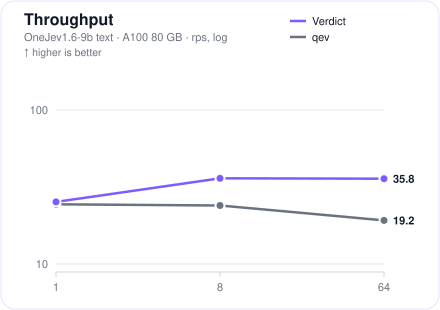
  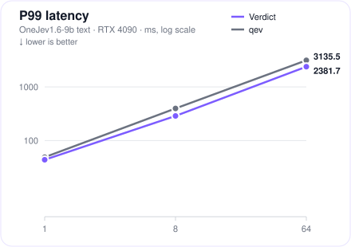
  <br><b>text</b>
</p>

<p align="center">
  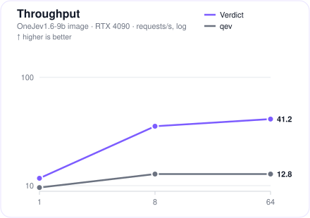
  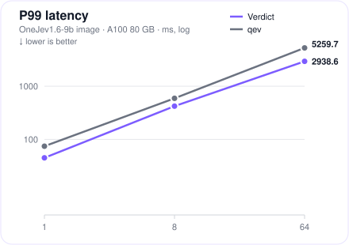
  <br><b>image</b>
</p>

<p align="center">
  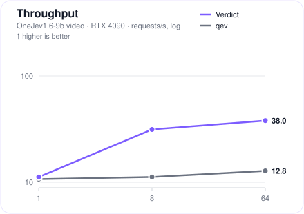
  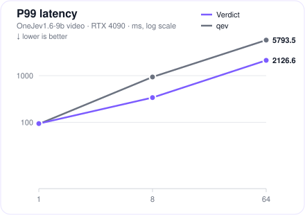
  <br><b>video</b>
</p>

`qev` did not pass the video test at concurrency 64, so its value is n/a.

</details>

<details open>
<summary><strong>decider-2b</strong></summary>

<p align="center">
  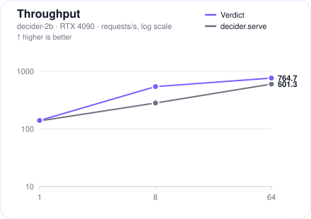
  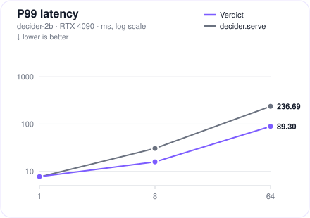
  <br><b>GPU only</b>
</p>

</details>

<details>
<summary><strong>von</strong></summary>

<p align="center">
  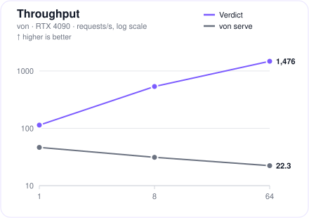
  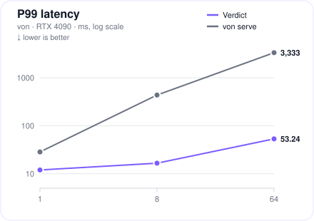
  <br><b>GPU</b>
</p>

<p align="center">
  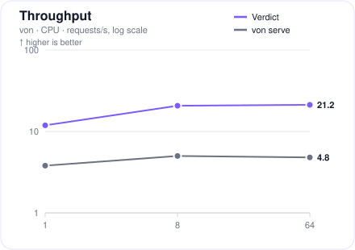
  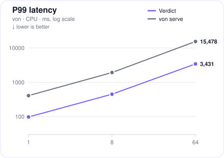
  <br><b>CPU</b>
</p>

</details>

<details>
<summary><strong>laya-multilingual</strong></summary>

<p align="center">
  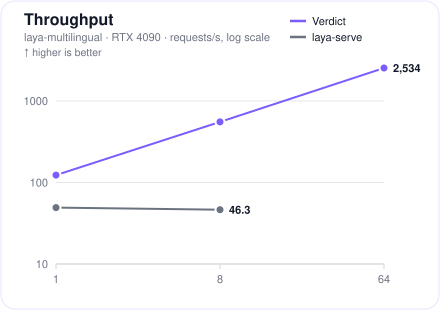
  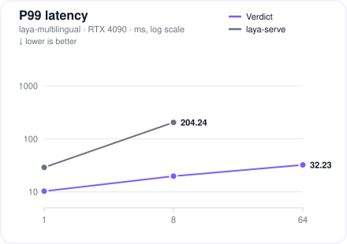
  <br><b>GPU</b>
</p>

<p align="center">
  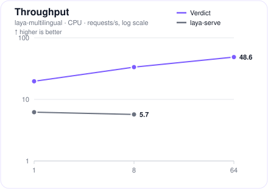
  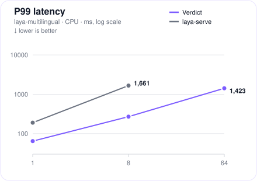
  <br><b>CPU</b>
</p>

The official server refused requests at concurrency 64, so its line ends at concurrency 8.

</details>

<details>
<summary><strong>laya</strong></summary>

<p align="center">
  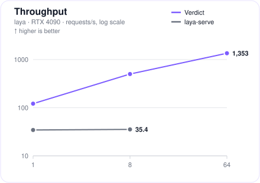
  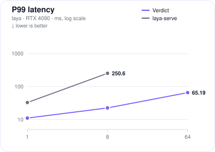
  <br><b>GPU</b>
</p>

<p align="center">
  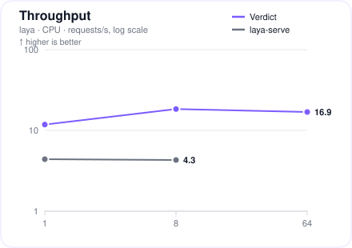
  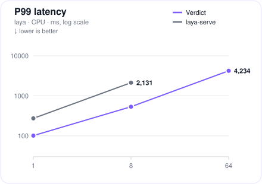
  <br><b>CPU</b>
</p>

The official server refused requests at concurrency 64, so its line ends at concurrency 8.

</details>

## Quick start

```bash
# the -v mount caches the model: the first run downloads it, later runs reuse the cache
docker run --rm --gpus all -p 8080:8080 \
    -v ~/.cache/verdict:/root/.cache/verdict \
    sgyaqing/verdict:latest-cuda serve verdict-models/OneJev1.6:9b --host 0.0.0.0

# ModelScope:
docker run --rm --gpus all -p 8080:8080 \
    -e VERDICT_USE_MODELSCOPE=1 \
    -v ~/.cache/verdict:/root/.cache/verdict \
    sgyaqing/verdict:latest-cuda serve sgyaqing/OneJev1.6:9b --host 0.0.0.0
```

Once started, you can test it with:

```bash
curl -s localhost:8080/v1/choice -H 'content-type: application/json' -d '{
  "question": "What should I do for dinner tonight?",
  "state": "Fridge is empty, it'\''s late, and I'\''m tired.",
  "options": ["order delivery", "cook pasta", "skip dinner"]}'
```

## Supported Models

| Verdict-ready&nbsp;model | Languages | One&nbsp;command |
|---|---|---|
| [`verdict-models/OneJev1.6`](https://huggingface.co/verdict-models/OneJev1.6) (variant family: 0.8b / 4b / 9b / 27b) | English | `verdict serve verdict-models/OneJev1.6:9b` |
| [`verdict-models/decider-2b`](https://huggingface.co/verdict-models/decider-2b) | English | `verdict serve verdict-models/decider-2b` |
| [`verdict-models/von`](https://huggingface.co/verdict-models/von) | English | `verdict serve verdict-models/von` |
| [`verdict-models/laya-multilingual`](https://huggingface.co/verdict-models/laya-multilingual) | 100+ languages | `verdict serve verdict-models/laya-multilingual` |
| [`verdict-models/laya`](https://huggingface.co/verdict-models/laya) | English | `verdict serve verdict-models/laya` |

Any checkpoint of the laya (laya-multilingual included) and von families also serves — the laya authors' [typed-decisions](https://huggingface.co/convaiinnovations/laya-typed-decisions) checkpoint, a fine-tune, a newer revision — after a one-time conversion; see **Conversion**.

All five are also mirrored on ModelScope, in the `sgyaqing` namespace:

```bash
# fetches from ModelScope instead of Hugging Face
VERDICT_USE_MODELSCOPE=1 verdict serve sgyaqing/von
```

### Variant families

Some packages are variant families — several model sizes under one repo, picked with a `:variant` tag:

```bash
verdict serve verdict-models/decider-2b     # a plain package: one model per repo
verdict serve verdict-models/OneJev1.6:9b   # a variant family: pick a size with :variant
```

Omitting the tag on a variant family is an error; the output lists the available variants:

```console
$ verdict serve verdict-models/OneJev1.6
error: verdict-models/OneJev1.6 is a variant family; pick one with verdict-models/OneJev1.6:<variant>
available:
  0.8b
  4b
  9b
  27b
example: verdict serve verdict-models/OneJev1.6:0.8b
```

A family served from a local path is served by its variant subdirectory: `verdict serve ~/models/OneJev1.6/9b`.

## Conversion

The table above lists the Verdict-ready packages we publish. Conversion covers encoder models only, and this release converts two families: laya (laya-multilingual included) and von. Any checkpoint of these families — a fine-tune, a newer revision — can become one: `verdict convert` turns it into a Verdict-ready package.

The conversion runs in two steps, both in the verdict-convert image: `verdict download` fetches the checkpoint to local disk first, then `verdict convert` turns it into a package.

This example converts the laya authors' typed-decisions checkpoint, which ships as a checkpoint but has no Verdict-ready package:

```bash
# fetch the checkpoint
docker run --rm -v ~/models:/work sgyaqing/verdict:latest-convert \
    download convaiinnovations/laya-typed-decisions /work/laya-typed

# convert it into a Verdict-ready package
docker run --rm -v ~/models:/work sgyaqing/verdict:latest-convert \
    convert /work/laya-typed /work/laya-typed-output

# serve it like any Verdict-ready model
docker run --rm --gpus all -p 8080:8080 \
    -v ~/models/laya-typed-output:/model \
    sgyaqing/verdict:latest-cuda serve /model --host 0.0.0.0
```

## API

### `/v1/systemone`

The System One category's native API, defined by Jev and implemented by Laya's runtime, Ollama, LiteLLM, and more.

```bash
curl -s localhost:8080/v1/systemone -H 'content-type: application/json' -d '{
  "state": "Fridge is empty, it'\''s late, and I'\''m tired.",
  "questions": {
    "dinner": {"type": "choice", "instructions": "What should I do for dinner tonight?",
               "criteria": {"order delivery": null, "cook pasta": null, "skip dinner": null}},
    "too_late": {"type": "noul", "instructions": "Is it too late to start cooking?"}
  }}'
```

```json
{
  "model": "OneJev1.6:9b",
  "answers": {
    "dinner": {"type": "choice", "choice": "skip dinner",
               "probabilities": {"order delivery": 0.0124, "cook pasta": 0.0786, "skip dinner": 0.909},
               "confidence": 0.6895},
    "too_late": {"type": "noul", "noul": 0.5068}
  },
  "usage": {"input_tokens": 88, "output_tokens": 0}
}
```

With an image — `assets` carries the bytes, and the reference name in `state` marks where the image goes:

```bash
curl -s localhost:8080/v1/systemone -H 'content-type: application/json' -d '{
  "state": {"screen": "shot-1", "task": "Pay the open invoice from ACME"},
  "questions": {
    "shape": {"type": "choice", "instructions": "Which shape is blue?",
              "criteria": {"circle": "a round shape", "rectangle": "a box", "none": "no blue shape"}}
  },
  "assets": {"shot-1": {"type": "image", "format": "png", "data_base64": "<base64 image bytes>"}}
}'
```

With a video — caller-extracted frames plus the capture rate:

```bash
curl -s localhost:8080/v1/systemone -H 'content-type: application/json' -d '{
  "state": {"recording": "rec-1", "goal": "Sort the invoices by vendor"},
  "questions": {
    "next": {"type": "choice", "instructions": "What should the agent do next?",
             "criteria": {"click": "click an element", "stop": "stop", "scroll": "scroll the list"}}
  },
  "assets": {"rec-1": {"type": "video", "fps": 2.0,
                       "frames": [{"format": "png", "data_base64": "<base64 frame>"},
                                  {"format": "png", "data_base64": "<base64 frame>"}]}}
}'
```

Media needs a media-capable model (such as the `OneJev1.6` variants); a text-only model rejects `assets` with an error.

With the official `typesafe-sdk`:

```python
from typesafe_sdk import TypeSafeClient

client = TypeSafeClient(api_key="local", base_url="http://127.0.0.1:8080")
r = client.system_one(
    "Fridge is empty, it's late, and I'm tired.",
    {
        "dinner": {"type": "choice",
                   "instructions": "What should I do for dinner tonight?",
                   "criteria": {"order delivery": None, "cook pasta": None, "skip dinner": None}},
        "too_late": {"type": "noul", "instructions": "Is it too late to start cooking?"},
    },
)
r.answers["dinner"].choice        # "skip dinner"
r.answers["dinner"].confidence    # 0.6895
```

### `/v1/decisions`

The OpenAI Decisions protocol, defined by OpenAI and implemented by LiteLLM, SGLang, and more.

```bash
curl -s localhost:8080/v1/decisions -H 'content-type: application/json' -d '{
  "model": "OneJev1.6:9b",
  "input": "Fridge is empty, it'\''s late, and I'\''m tired.",
  "questions": [
    {"type": "choice", "name": "dinner", "instructions": "What should I do for dinner tonight?",
     "choices": [{"value": "order delivery"}, {"value": "cook pasta"}, {"value": "skip dinner"}]},
    {"type": "predicate", "name": "too_late", "instructions": "Is it too late to start cooking?"}
  ]}'
```

```json
{
  "model": "OneJev1.6:9b",
  "answers": [
    {"type": "choice", "name": "dinner", "choice": "skip dinner", "confidence": 0.6895,
     "probabilities": [{"value": "order delivery", "probability": 0.0124},
                       {"value": "cook pasta", "probability": 0.0786},
                       {"value": "skip dinner", "probability": 0.909}]},
    {"type": "predicate", "name": "too_late", "probability": 0.5068}
  ],
  "usage": {"input_tokens": 88, "output_tokens": 0, "total_tokens": 88,
            "input_tokens_details": {"cache_write_tokens": 0, "cached_tokens": 0},
            "output_tokens_details": {"reasoning_tokens": 0}}
}
```

With an image — the Responses-API shape: `input` is a user message whose `content` mixes `input_text` and `input_image` parts (data URIs only):

```bash
curl -s localhost:8080/v1/decisions -H 'content-type: application/json' -d '{
  "model": "OneJev1.6:9b",
  "input": [{"role": "user", "content": [
    {"type": "input_text", "text": "Task: Pay the open invoice from ACME"},
    {"type": "input_image", "image_url": "data:image/png;base64,<base64 image bytes>"}]}],
  "questions": [
    {"type": "choice", "name": "shape", "instructions": "Which shape is blue?",
     "choices": [{"value": "circle"}, {"value": "rectangle"}, {"value": "none"}]}]}'
```

Verdict accepts text and images on `/v1/decisions`, but not video.

With the official `openai` SDK (>= 3.26):

```python
from openai import OpenAI

client = OpenAI(base_url="http://127.0.0.1:8080/v1", api_key="local")
d = client.decisions.create(
    model="OneJev1.6:9b",
    input="Fridge is empty, it's late, and I'm tired.",
    questions=[
        {"type": "choice", "name": "dinner",
         "instructions": "What should I do for dinner tonight?",
         "choices": [{"value": "order delivery"}, {"value": "cook pasta"}, {"value": "skip dinner"}]},
        {"type": "predicate", "name": "too_late",
         "instructions": "Is it too late to start cooking?"},
    ],
)
d.answers[0].choice        # "skip dinner"
d.answers[0].confidence    # 0.6895
```

### Single-question endpoints

One question per call; text only.

| Endpoint | Request | Response |
|---|---|---|
| `POST /v1/choice` | `{"question": "Dinner tonight?", "state": "Fridge is empty, it's late.", "options": ["order delivery", "cook pasta"]}` | `{"choice":1,"probabilities":[0.0963,0.9037],"usage":{"input_tokens":25},"latency_ms":22}` |
| `POST /v1/score` | `{"question": "How polite is this reply?", "state": "Support reply: we refunded your order, sorry for the trouble.", "levels": ["terse", "neutral", "warm"]}` | `{"score":0.7665,"probabilities":[0.2348,0.7639,0.0013],"usage":{"input_tokens":44},"latency_ms":26}` |
| `POST /v1/noul` | `{"claim": "The customer got their money back", "state": "Support reply: we refunded your order, sorry for the trouble."}` | `{"probability":0.9587,"usage":{"input_tokens":45},"latency_ms":25}` |

### OpenAI-compatible layer

`/v1/chat/completions` and `/v1/models`, for SDK compatibility:

```python
from openai import OpenAI

client = OpenAI(base_url="http://127.0.0.1:8080/v1", api_key="local")
r = client.chat.completions.create(
    model="<served-model-name>",
    messages=[{"role": "user", "content": "What should I do for dinner tonight?"}],
    extra_body={
        "state": "Fridge is empty, it's late, and I'm tired.",
        "options": ["order delivery", "cook pasta", "skip dinner"],
    },
)
print(r.choices[0].message.content)   # the selected option, e.g. "skip dinner"
print(r.model_extra["verdict"])       # {"choice": 2, "probabilities": [...]}
```

Decision fields ride as top-level extensions via `extra_body`; whichever is present picks the task: `options` → choice, `levels` → score, `claim` → noul. Text only.

### `/health` and `/metrics`

`GET /health` answers `{"status":"ok","version":"0.4.0"}` once every engine replica is serving, and a 503 with `{"status":"unavailable", ...}` while any replica is unhealthy. The first boot may compile for minutes before its first ok — poll this endpoint and read earlier silence as loading, not failure.

`GET /metrics` serves Prometheus text:

```text
verdict_requests_total{task="choice"} 153
verdict_queue_depth{replica="0"} 7
```

Six families: `verdict_requests_total{task}` and `verdict_decision_latency_seconds{task}` count and time served decisions; `verdict_queue_depth{replica}` and `verdict_in_flight` gauge queued and executing requests; `verdict_batch_rows{replica}` and `verdict_batches_total` describe batch fullness. For tuning, read `verdict_queue_depth` together with `/graph` (see **Optimization**).

### `/graph`

Coverage report for the CUDA graphs: which graph cells boot planned and captured, which served rows missed a graph and why, and the GPU memory budget the instance runs under.

```json
{
  "envelope": {"max_len": 1024, "max_rows": 16, "fork_max_prefix": 4096, "fork_max_width": 64,
               "gpu_memory_utilization": 0.92, "budget_bytes": 23697524942,
               "reserved_bytes": 6442450944, "transient_bytes": 1073741824},
  "cells": {"text": {"captured": 60, "planned": 60},
            "media": {"captured": 5, "planned": 5},
            "fork": {"captured": 128, "planned": 128}},
  "served_rows": 40213,
  "eager": {"total": 0.0, "len": 0.0, "rows": 0.0, "degraded": 0.0},
  "fork": {"total": 0.0, "prefix": 0.0, "width": 0.0, "rows": 0.0, "degraded": 0.0, "not_applicable": 0.0},
  "replicas": 1
}
```

For acting on these numbers see **Optimization**.

### Errors

All errors share one JSON structure -- sending one option to `/v1/choice`, for example:

```json
{"error":{"type":"invalid_request","message":"options must contain at least 2 items (got 1)"}}
```

| `type` | HTTP | when |
|---|---|---|
| `invalid_request` | 400 | malformed body, failed validation, prompts above the input token budget |
| `not_found` | 404 | unknown route |
| `payload_too_large` | 413 | body above `--max-body-mb` (default 64 MiB) |
| `internal` | 500 | engine failure |
| `overloaded` | 503 | queue full -- the request is refused, never dropped |

## Performance

All numbers measured end to end over HTTP, each model against its author's own server on the host named in its heading (`laya-serve` 0.4.7, `von serve` from von-sdk 1.3.7, `decider.serve_vllm` from decider-ai 1.9.0 on vLLM 0.29.0, `qev` 0.1.4 for OneJev1.6). CPU measurements were taken on the same host with the GPU idle. A ratio above 1x means Verdict is ahead. Servers run with their default parameters unless a model's section notes otherwise. Click a model to expand its tables. The laya, von and laya-multilingual cells were measured with a fixed-count method: 300, 800 and 6400 requests at concurrency 1, 8 and 64, with `--max-batch-size 8`. OneJev1.6 cells are a 10-second run after warm-up at that concurrency; decider-2b cells are a 30-second run, the first 10 seconds discarded as warm-up (the opening seconds are the queue filling, not steady state); for both, throughput is the number of completed responses inside the window divided by its length, and a cell is reported only if the server sustained at least two full rounds of its concurrency.

<details>
<summary><strong>OneJev1.6-0.8b</strong> (RTX 4090 48 GB)</summary>

All cells with `--max-batch-size 8 --graph-max-len 512` except concurrency-1 cells with `--max-batch-size 2 --batch-window-ms 1`.

**text**

| concurrency | Verdict&nbsp;rps | `qev`&nbsp;rps | rps&nbsp;ratio | Verdict&nbsp;P50&nbsp;/&nbsp;P99&nbsp;(ms) | `qev`&nbsp;P50&nbsp;/&nbsp;P99&nbsp;(ms) | P50&nbsp;/&nbsp;P99&nbsp;ratio |
|---:|---:|---:|---:|---:|---:|---:|
| 1 | 116.7 | 87.5 | 1.33x | 8.90&nbsp;/&nbsp;9.30 | 11.37&nbsp;/&nbsp;11.93 | 1.28x&nbsp;/&nbsp;1.28x |
| 8 | 245.7 | 89.9 | 2.73x | 33.16&nbsp;/&nbsp;35.56 | 89.42&nbsp;/&nbsp;91.05 | 2.70x&nbsp;/&nbsp;2.56x |
| 64 | 289.5 | 89.6 | 3.23x | 225.43&nbsp;/&nbsp;228.53 | 693.37&nbsp;/&nbsp;928.39 | 3.08x&nbsp;/&nbsp;4.06x |

**image**

| concurrency | Verdict&nbsp;rps | `qev`&nbsp;rps | rps&nbsp;ratio | Verdict&nbsp;P50&nbsp;/&nbsp;P99&nbsp;(ms) | `qev`&nbsp;P50&nbsp;/&nbsp;P99&nbsp;(ms) | P50&nbsp;/&nbsp;P99&nbsp;ratio |
|---:|---:|---:|---:|---:|---:|---:|
| 1 | 37.5 | 38.0 | 0.99x | 26.86&nbsp;/&nbsp;28.70 | 26.31&nbsp;/&nbsp;28.73 | 0.98x&nbsp;/&nbsp;1.00x |
| 8 | 135.6 | 38.4 | 3.53x | 59.09&nbsp;/&nbsp;60.98 | 205.37&nbsp;/&nbsp;422.47 | 3.48x&nbsp;/&nbsp;6.93x |
| 64 | 141.2 | 44.8 | 3.15x | 472.29&nbsp;/&nbsp;479.76 | 1639.10&nbsp;/&nbsp;1697.90 | 3.47x&nbsp;/&nbsp;3.54x |

**video**

| concurrency | Verdict&nbsp;rps | `qev`&nbsp;rps | rps&nbsp;ratio | Verdict&nbsp;P50&nbsp;/&nbsp;P99&nbsp;(ms) | `qev`&nbsp;P50&nbsp;/&nbsp;P99&nbsp;(ms) | P50&nbsp;/&nbsp;P99&nbsp;ratio |
|---:|---:|---:|---:|---:|---:|---:|
| 1 | 30.1 | 26.8 | 1.12x | 32.24&nbsp;/&nbsp;40.02 | 31.30&nbsp;/&nbsp;35.30 | 0.97x&nbsp;/&nbsp;0.88x |
| 8 | 109.2 | 31.5 | 3.47x | 72.57&nbsp;/&nbsp;83.08 | 251.40&nbsp;/&nbsp;464.83 | 3.46x&nbsp;/&nbsp;5.59x |
| 64 | 115.2 | 32.0 | 3.60x | 583.80&nbsp;/&nbsp;608.71 | 2018.50&nbsp;/&nbsp;2143.50 | 3.46x&nbsp;/&nbsp;3.52x |

</details>

<details>
<summary><strong>OneJev1.6-4b</strong> (RTX 4090 48 GB)</summary>

All cells with `--max-batch-size 8 --graph-max-len 512` except concurrency-1 cells with `--max-batch-size 2 --batch-window-ms 1`.

**text**

| concurrency | Verdict&nbsp;rps | `qev`&nbsp;rps | rps&nbsp;ratio | Verdict&nbsp;P50&nbsp;/&nbsp;P99&nbsp;(ms) | `qev`&nbsp;P50&nbsp;/&nbsp;P99&nbsp;(ms) | P50&nbsp;/&nbsp;P99&nbsp;ratio |
|---:|---:|---:|---:|---:|---:|---:|
| 1 | 38.1 | 31.3 | 1.22x | 25.98&nbsp;/&nbsp;27.01 | 31.99&nbsp;/&nbsp;32.38 | 1.23x&nbsp;/&nbsp;1.20x |
| 8 | 47.3 | 32.3 | 1.46x | 163.49&nbsp;/&nbsp;185.22 | 253.52&nbsp;/&nbsp;254.76 | 1.55x&nbsp;/&nbsp;1.38x |
| 64 | 55.2 | 32.0 | 1.72x | 1275.20&nbsp;/&nbsp;1425.70 | 2017.70&nbsp;/&nbsp;2243.00 | 1.58x&nbsp;/&nbsp;1.57x |

**image**

| concurrency | Verdict&nbsp;rps | `qev`&nbsp;rps | rps&nbsp;ratio | Verdict&nbsp;P50&nbsp;/&nbsp;P99&nbsp;(ms) | `qev`&nbsp;P50&nbsp;/&nbsp;P99&nbsp;(ms) | P50&nbsp;/&nbsp;P99&nbsp;ratio |
|---:|---:|---:|---:|---:|---:|---:|
| 1 | 17.2 | 16.8 | 1.02x | 57.51&nbsp;/&nbsp;60.47 | 57.68&nbsp;/&nbsp;60.92 | 1.00x&nbsp;/&nbsp;1.01x |
| 8 | 51.6 | 17.6 | 2.93x | 156.16&nbsp;/&nbsp;160.33 | 461.55&nbsp;/&nbsp;706.21 | 2.96x&nbsp;/&nbsp;4.41x |
| 64 | 56.8 | 19.2 | 2.96x | 1254.90&nbsp;/&nbsp;1267.90 | 4074.00&nbsp;/&nbsp;4076.10 | 3.25x&nbsp;/&nbsp;3.21x |

**video**

| concurrency | Verdict&nbsp;rps | `qev`&nbsp;rps | rps&nbsp;ratio | Verdict&nbsp;P50&nbsp;/&nbsp;P99&nbsp;(ms) | `qev`&nbsp;P50&nbsp;/&nbsp;P99&nbsp;(ms) | P50&nbsp;/&nbsp;P99&nbsp;ratio |
|---:|---:|---:|---:|---:|---:|---:|
| 1 | 15.2 | 13.2 | 1.15x | 65.60&nbsp;/&nbsp;73.36 | 64.40&nbsp;/&nbsp;71.10 | 0.98x&nbsp;/&nbsp;0.97x |
| 8 | 45.3 | 16.0 | 2.83x | 176.36&nbsp;/&nbsp;239.65 | 512.21&nbsp;/&nbsp;572.87 | 2.90x&nbsp;/&nbsp;2.39x |
| 64 | 51.2 | 19.2 | 2.67x | 1409.70&nbsp;/&nbsp;1514.20 | 4451.10&nbsp;/&nbsp;4452.30 | 3.16x&nbsp;/&nbsp;2.94x |

</details>

<details open>
<summary><strong>OneJev1.6-9b</strong> (A100 80 GB)</summary>

**text**

| concurrency | Verdict&nbsp;rps | `qev`&nbsp;rps | rps&nbsp;ratio | Verdict&nbsp;P50&nbsp;/&nbsp;P99&nbsp;(ms) | `qev`&nbsp;P50&nbsp;/&nbsp;P99&nbsp;(ms) | P50&nbsp;/&nbsp;P99&nbsp;ratio |
|---:|---:|---:|---:|---:|---:|---:|
| 1 | 25.3 | 24.4 | 1.04x | 39.63&nbsp;/&nbsp;40.51 | 40.91&nbsp;/&nbsp;41.30 | 1.03x&nbsp;/&nbsp;1.02x |
| 8 | 36.0 | 24.0 | 1.50x | 218.55&nbsp;/&nbsp;221.13 | 324.49&nbsp;/&nbsp;342.35 | 1.48x&nbsp;/&nbsp;1.55x |
| 64 | 35.8 | 19.2 | 1.86x | 1783.20&nbsp;/&nbsp;2094.50 | 2591.80&nbsp;/&nbsp;2672.30 | 1.45x&nbsp;/&nbsp;1.28x |

**image**

| concurrency | Verdict&nbsp;rps | `qev`&nbsp;rps | rps&nbsp;ratio | Verdict&nbsp;P50&nbsp;/&nbsp;P99&nbsp;(ms) | `qev`&nbsp;P50&nbsp;/&nbsp;P99&nbsp;(ms) | P50&nbsp;/&nbsp;P99&nbsp;ratio |
|---:|---:|---:|---:|---:|---:|---:|
| 1 | 21.2 | 13.3 | 1.59x | 43.42&nbsp;/&nbsp;45.08 | 74.44&nbsp;/&nbsp;75.36 | 1.71x&nbsp;/&nbsp;1.67x |
| 8 | 22.2 | 13.6 | 1.63x | 374.78&nbsp;/&nbsp;422.07 | 587.00&nbsp;/&nbsp;592.19 | 1.57x&nbsp;/&nbsp;1.40x |
| 64 | 20.9 | 12.8 | 1.63x | 2868.40&nbsp;/&nbsp;2938.60 | 5257.50&nbsp;/&nbsp;5259.70 | 1.83x&nbsp;/&nbsp;1.79x |

**video**

| concurrency | Verdict&nbsp;rps | `qev`&nbsp;rps | rps&nbsp;ratio | Verdict&nbsp;P50&nbsp;/&nbsp;P99&nbsp;(ms) | `qev`&nbsp;P50&nbsp;/&nbsp;P99&nbsp;(ms) | P50&nbsp;/&nbsp;P99&nbsp;ratio |
|---:|---:|---:|---:|---:|---:|---:|
| 1 | 19.2 | 11.8 | 1.63x | 51.77&nbsp;/&nbsp;56.12 | 83.68&nbsp;/&nbsp;87.75 | 1.62x&nbsp;/&nbsp;1.56x |
| 8 | 20.5 | 12.1 | 1.69x | 381.89&nbsp;/&nbsp;461.59 | 645.15&nbsp;/&nbsp;652.86 | 1.69x&nbsp;/&nbsp;1.41x |
| 64 | 19.3 | n/a&nbsp;&dagger; | &mdash; | 3099.90&nbsp;/&nbsp;3347.90 | &mdash; | &mdash; |

&dagger; `qev` completed one round of the 64 clients inside the window, the rest in flight at the deadline, so the cell is n/a.

</details>

<details>
<summary><strong>OneJev1.6-27b</strong> (A100 80 GB)</summary>

Verdict runs this tier eager (`VERDICT_TORCH_GRAPHS=0`): the CUDA graphs do fit the 80 GB card, but their static pools leave no room for batch capacity, and media throughput at concurrency 8 and 64 drops by roughly two thirds. The same tier was eager in the 0.3.0 numbers, so the two releases are directly comparable.

**text**

| concurrency | Verdict&nbsp;rps | `qev`&nbsp;rps | rps&nbsp;ratio | Verdict&nbsp;P50&nbsp;/&nbsp;P99&nbsp;(ms) | `qev`&nbsp;P50&nbsp;/&nbsp;P99&nbsp;(ms) | P50&nbsp;/&nbsp;P99&nbsp;ratio |
|---:|---:|---:|---:|---:|---:|---:|
| 1 | 9.1 | 8.5 | 1.07x | 109.02&nbsp;/&nbsp;111.21 | 116.80&nbsp;/&nbsp;118.43 | 1.07x&nbsp;/&nbsp;1.06x |
| 8 | 12.0 | 8.0 | 1.50x | 655.60&nbsp;/&nbsp;658.29 | 933.53&nbsp;/&nbsp;966.40 | 1.42x&nbsp;/&nbsp;1.47x |
| 64 | 11.2 | n/a&nbsp;&dagger; | &mdash; | 4466.50&nbsp;/&nbsp;5737.10 | &mdash; | &mdash; |

**image**

| concurrency | Verdict&nbsp;rps | `qev`&nbsp;rps | rps&nbsp;ratio | Verdict&nbsp;P50&nbsp;/&nbsp;P99&nbsp;(ms) | `qev`&nbsp;P50&nbsp;/&nbsp;P99&nbsp;(ms) | P50&nbsp;/&nbsp;P99&nbsp;ratio |
|---:|---:|---:|---:|---:|---:|---:|
| 1 | 4.0 | 5.6 | 0.71x | 244.69&nbsp;/&nbsp;248.87 | 175.06&nbsp;/&nbsp;179.04 | 0.72x&nbsp;/&nbsp;0.72x |
| 8 | 17.6 | 5.6 | 3.14x | 447.61&nbsp;/&nbsp;454.15 | 1400.20&nbsp;/&nbsp;1401.90 | 3.13x&nbsp;/&nbsp;3.09x |
| 64 | 16.7 | n/a&nbsp;&dagger; | &mdash; | 3528.60&nbsp;/&nbsp;3934.30 | &mdash; | &mdash; |

**video**

| concurrency | Verdict&nbsp;rps | `qev`&nbsp;rps | rps&nbsp;ratio | Verdict&nbsp;P50&nbsp;/&nbsp;P99&nbsp;(ms) | `qev`&nbsp;P50&nbsp;/&nbsp;P99&nbsp;(ms) | P50&nbsp;/&nbsp;P99&nbsp;ratio |
|---:|---:|---:|---:|---:|---:|---:|
| 1 | 3.9 | 5.2 | 0.75x | 252.52&nbsp;/&nbsp;273.82 | 183.82&nbsp;/&nbsp;317.76 | 0.73x&nbsp;/&nbsp;1.16x |
| 8 | 16.8 | 4.8 | 3.50x | 455.36&nbsp;/&nbsp;569.37 | 1476.50&nbsp;/&nbsp;1578.80 | 3.24x&nbsp;/&nbsp;2.77x |
| 64 | 17.1 | n/a&nbsp;&dagger; | &mdash; | 3620.80&nbsp;/&nbsp;4005.50 | &mdash; | &mdash; |

&dagger; At `c=64`, `qev` cannot carry the offered concurrency: it completed 64, 8 and 0 responses in the text, image and video cells — the rest in flight at the deadline, so all three cells are n/a.

</details>

<details open>
<summary><strong>decider-2b</strong> (RTX 4090 24 GB)</summary>

**GPU**

| concurrency | Verdict&nbsp;rps | `decider.serve_vllm`&nbsp;rps | rps&nbsp;ratio | Verdict&nbsp;P50&nbsp;/&nbsp;P99&nbsp;(ms) | `decider.serve_vllm`&nbsp;P50&nbsp;/&nbsp;P99&nbsp;(ms) | P50&nbsp;/&nbsp;P99&nbsp;ratio |
|---:|---:|---:|---:|---:|---:|---:|
| 1 | 33.6 | 14.0 | 2.40x | 27.90&nbsp;/&nbsp;60.90 | 66.30&nbsp;/&nbsp;138.80 | 2.38x&nbsp;/&nbsp;2.28x |
| 8 | 49.2 | 39.5 | 1.25x | 163.80&nbsp;/&nbsp;248.10 | 175.00&nbsp;/&nbsp;416.30 | 1.07x&nbsp;/&nbsp;1.68x |
| 64 | 47.5 | 43.7 | 1.09x | 1262.70&nbsp;/&nbsp;1443.90 | 1184.80&nbsp;/&nbsp;2394.80 | 0.94x&nbsp;/&nbsp;1.66x |

</details>

<details>
<summary><strong>von</strong> (RTX 4090 24 GB)</summary>

**GPU**

| concurrency | Verdict&nbsp;rps | `von serve`&nbsp;rps | rps&nbsp;ratio | Verdict&nbsp;P50&nbsp;/&nbsp;P99&nbsp;(ms) | `von serve`&nbsp;P50&nbsp;/&nbsp;P99&nbsp;(ms) | P50&nbsp;/&nbsp;P99&nbsp;ratio |
|---|---:|---:|---:|---:|---:|---:|
| 1 | 113.8 | 46.4 | 2.45x | 8.61&nbsp;/&nbsp;11.98 | 22.89&nbsp;/&nbsp;28.46 | 2.66&nbsp;/&nbsp;2.38x |
| 8 | 536.4 | 31.2 | 17.2x | 14.86&nbsp;/&nbsp;16.61 | 250.91&nbsp;/&nbsp;435.99 | 16.9&nbsp;/&nbsp;26.2x |
| 64 | 1476.1 | 22.3 | 66.1x | 42.58&nbsp;/&nbsp;53.24 | 2848.80&nbsp;/&nbsp;3333.40 | 66.9&nbsp;/&nbsp;62.6x |

**CPU** (AMD EPYC 7543)

| concurrency | Verdict&nbsp;rps | `von serve`&nbsp;rps | rps&nbsp;ratio | Verdict&nbsp;P50&nbsp;/&nbsp;P99&nbsp;(ms) | `von serve`&nbsp;P50&nbsp;/&nbsp;P99&nbsp;(ms) | P50&nbsp;/&nbsp;P99&nbsp;ratio |
|---|---:|---:|---:|---:|---:|---:|
| 1 | 11.9 | 3.8 | 3.11x | 83.11&nbsp;/&nbsp;97.55 | 272.53&nbsp;/&nbsp;409.13 | 3.28&nbsp;/&nbsp;4.19x |
| 8 | 20.7 | 5.0 | 4.17x | 383.82&nbsp;/&nbsp;449.74 | 1607.00&nbsp;/&nbsp;1927.80 | 4.19&nbsp;/&nbsp;4.29x |
| 64 | 21.2 | 4.8 | 4.37x | 2989.60&nbsp;/&nbsp;3430.80 | 13644.60&nbsp;/&nbsp;15478.20 | 4.56&nbsp;/&nbsp;4.51x |

</details>

<details>
<summary><strong>laya-multilingual</strong> (RTX 4090 24 GB)</summary>

**GPU**

| concurrency | Verdict&nbsp;rps | `laya-serve`&nbsp;rps | rps&nbsp;ratio | Verdict&nbsp;P50&nbsp;/&nbsp;P99&nbsp;(ms) | `laya-serve`&nbsp;P50&nbsp;/&nbsp;P99&nbsp;(ms) | P50&nbsp;/&nbsp;P99&nbsp;ratio |
|---|---:|---:|---:|---:|---:|---:|
| 1 | 123.2 | 49.1 | 2.51x | 8.03&nbsp;/&nbsp;10.29 | 18.54&nbsp;/&nbsp;28.92 | 2.31&nbsp;/&nbsp;2.81x |
| 8 | 553.4 | 46.3 | 11.9x | 13.99&nbsp;/&nbsp;19.79 | 184.36&nbsp;/&nbsp;204.24 | 13.2&nbsp;/&nbsp;10.3x |
| 64 | 2534.4 | refused&nbsp;requests | — | 24.67&nbsp;/&nbsp;32.23 | refused&nbsp;requests | — |

**CPU** (AMD EPYC 7543)

| concurrency | Verdict&nbsp;rps | `laya-serve`&nbsp;rps | rps&nbsp;ratio | Verdict&nbsp;P50&nbsp;/&nbsp;P99&nbsp;(ms) | `laya-serve`&nbsp;P50&nbsp;/&nbsp;P99&nbsp;(ms) | P50&nbsp;/&nbsp;P99&nbsp;ratio |
|---|---:|---:|---:|---:|---:|---:|
| 1 | 19.7 | 6.2 | 3.16x | 50.51&nbsp;/&nbsp;64.37 | 161.13&nbsp;/&nbsp;189.54 | 3.19&nbsp;/&nbsp;2.94x |
| 8 | 33.4 | 5.7 | 5.84x | 238.10&nbsp;/&nbsp;269.73 | 1396.60&nbsp;/&nbsp;1661.30 | 5.87&nbsp;/&nbsp;6.16x |
| 64 | 48.6 | refused&nbsp;requests | — | 1312.40&nbsp;/&nbsp;1422.60 | refused&nbsp;requests | — |

</details>

<details>
<summary><strong>laya</strong> (RTX 4090 24 GB)</summary>

**GPU**

| concurrency | Verdict&nbsp;rps | `laya-serve`&nbsp;rps | rps&nbsp;ratio | Verdict&nbsp;P50&nbsp;/&nbsp;P99&nbsp;(ms) | `laya-serve`&nbsp;P50&nbsp;/&nbsp;P99&nbsp;(ms) | P50&nbsp;/&nbsp;P99&nbsp;ratio |
|---|---:|---:|---:|---:|---:|---:|
| 1 | 121.4 | 34.4 | 3.53x | 8.37&nbsp;/&nbsp;11.07 | 28.58&nbsp;/&nbsp;32.73 | 3.42&nbsp;/&nbsp;2.96x |
| 8 | 501.4 | 35.4 | 14.2x | 15.99&nbsp;/&nbsp;22.42 | 227.96&nbsp;/&nbsp;250.60 | 14.3&nbsp;/&nbsp;11.2x |
| 64 | 1353.0 | refused&nbsp;requests | — | 46.71&nbsp;/&nbsp;65.19 | refused&nbsp;requests | — |

**CPU** (AMD EPYC 7543)

| concurrency | Verdict&nbsp;rps | `laya-serve`&nbsp;rps | rps&nbsp;ratio | Verdict&nbsp;P50&nbsp;/&nbsp;P99&nbsp;(ms) | `laya-serve`&nbsp;P50&nbsp;/&nbsp;P99&nbsp;(ms) | P50&nbsp;/&nbsp;P99&nbsp;ratio |
|---|---:|---:|---:|---:|---:|---:|
| 1 | 11.8 | 4.4 | 2.67x | 84.21&nbsp;/&nbsp;100.87 | 223.81&nbsp;/&nbsp;273.16 | 2.66&nbsp;/&nbsp;2.71x |
| 8 | 18.4 | 4.3 | 4.23x | 436.70&nbsp;/&nbsp;533.71 | 1882.50&nbsp;/&nbsp;2131.30 | 4.31&nbsp;/&nbsp;3.99x |
| 64 | 16.9 | refused&nbsp;requests | — | 3796.80&nbsp;/&nbsp;4233.90 | refused&nbsp;requests | — |

</details>

## Correctness

Verdict runs its own inference pipeline, graded against a golden standard: the official SDK's offline output on CPU fp32. In accuracy PKs, Verdict and the model author's own server are graded against the same golden standard on one CUDA host per model (RTX 4090; A100 for the OneJev1.6 9b and 27b tiers) — worst-case deviation across the whole corpus:

| Model | Verdict | official&nbsp;server | result |
|---|---:|---:|:--|
| laya | 0.0 | 0.943 | Verdict ahead |
| laya-multilingual | 1e-4 | 1.74 | Verdict ahead |
| von | 0.0 | 0.0 | tied |
| decider-2b | 1.00e-2 | 1.09e-2 | tied |
| OneJev1.6-0.8b | 2.49e-2 | 8.55e-1 | Verdict ahead |
| OneJev1.6-4b | 4.95e-2 | 9.03e-1 | Verdict ahead |
| OneJev1.6-9b | 3.91e-2 | 8.97e-1 | Verdict ahead |
| OneJev1.6-27b | 7.34e-2 | 7.80e-1 | Verdict ahead |

## Commands and Configuration

### serve

`verdict serve (<repo>[:variant] | <model_dir>)`

| Flag | Default | Meaning |
|---|---|---|
| `--host` / `--port` | 127.0.0.1&nbsp;/&nbsp;8080 | address and port to serve on |
| `--device` | auto | `auto` uses CUDA when available, else CPU; `cpu` / `cuda` force the choice |
| `--max-batch-size` | 16 | scheduler batch cap in rows |
| `--token-budget` | 16384 | tokens a batch may hold; rows per batch are capped at budget / length class |
| `--graph-max-len` | 1024 | longest prompt whose forward the torch runtime captures into a CUDA graph; longer prompts run eagerly, and a device without room for the ladder lowers the ceiling itself |
| `--gpu-memory-utilization` | 0.92 | fraction of GPU memory this instance may use — weights, CUDA graphs, caches; co-located servers each declare their share |
| `--fork-graph-max-prefix` | 4096 | longest shared prefix covered by the fork graphs; longer prefixes run the eager fork |
| `--fork-graph-max-width` | 64 | longest branch suffix covered by the fork graphs; longer suffixes run the eager fork |
| `--batch-window-ms` | 5 | batch accumulation time cap; a batch ships sooner when it fills up or after 0.5&nbsp;ms of arrival silence |
| `--max-input-tokens` | off | reject rendered prompts longer than this; unset, an over-long prompt is truncated at the model's declared `max_len`, same as the official SDK |
| `--max-body-mb` | 64 | request body size cap in MiB |
| `--queue-cap` | 1024 | max queued requests; excess requests are rejected with 503 |
| `--served-model-name` | model directory's name | the model name clients address |
| `--policy` | shape | `shape` groups rows of one length class into batches, so one long row cannot pad a whole batch; `fcfs` serves in arrival order; `priority` serves lower request priority first |
| `--data-parallel` | 1 | N engine replicas; helps on many-core CPU hosts |
| `--force-download` | — | if passed, re-download the model package instead of using the cache |

### download

`verdict download <repo> <local_dir>`

| Flag | Default | Meaning |
|---|---|---|
| `--progress json` | — | one JSON progress event per line on stdout, logs on stderr — for tools driving Verdict as a subprocess |

### convert

`verdict convert <local_dir> <output_local_dir>`

| Flag | Default | Meaning |
|---|---|---|
| `--progress json` | — | same as on `download` |

### Environment variables

| Variable | Effect |
|---|---|
| `HF_ENDPOINT` | Alternate Hugging Face endpoint, for fetching through a mirror. |
| `HF_TOKEN` | Auth for gated Hugging Face repos. |
| `VERDICT_USE_MODELSCOPE` | `1` or `true` resolves all repo ids against ModelScope; unset or any other value keeps everything on Hugging Face. |
| `MODELSCOPE_API_TOKEN` | Auth for ModelScope repos. |
| `VERDICT_CACHE` | Model cache root; default `$XDG_CACHE_HOME/verdict`, i.e. `~/.cache/verdict`. |
| `ORT_DYLIB_PATH` | Path to the onnxruntime library; default: the model's `lib/` or beside the binary. |

## Optimization

### What `/graph` says

At boot Verdict compiles the shapes within the ranges you declared into CUDA graphs — the fast path; shapes that do not fit, or fall outside those ranges, run the ordinary path (slower). `/graph` reports two things:

- whether boot captured every planned graph — planned against captured;
- what share of requests took the slow path under traffic, and why.

`curl http://<host>:<port>/graph` returns the JSON.

### When tuning is done

After a run of your own real traffic (at least ten minutes), the ideal reading is:

- every slow-path ratio at 0: `eager.len`, `eager.degraded` and `fork.degraded` all 0;
- every graph captured: `cells.text.captured` equals `cells.text.planned`, and `cells.fork.captured` equals `cells.fork.planned`.

At that point the parameters are as good as they get — stop there.

### Fix what you see

| You see | Meaning | Move |
|---|---|---|
| `eager.len` above 0 | your prompts exceed the `--graph-max-len` ceiling; those requests keep taking the slow path | double `--graph-max-len` — 1024 → 2048 → 4096 — restart and re-measure |
| `cells.text.captured` below `cells.text.planned` | the card could not hold every text graph at boot | halve `--graph-max-len` — 1024 → 512 → 256, down to 64 if needed — restart and re-measure |
| `eager.degraded` above 0 | requests hit text cells that did not capture | same as above: halve `--graph-max-len` |
| `cells.fork.captured` below `cells.fork.planned` | the card could not hold every fork graph at boot | halve `--fork-graph-max-width` — 64 → 32 → 16 — restart and re-measure |
| `fork.degraded` above 0 | rows hit fork cells that did not capture | same as above: halve `--fork-graph-max-width` |

Two notes:

- Cells that did not capture are visible right after boot, no load needed; the degraded ratios appear only after traffic.
- If cells would not capture, look at `nvidia-smi` first: when another process holds the card, free the card — no flag fixes that.

### Steps

1. Drive your own real workload for at least ten minutes. Confirm it saturates first: `verdict_queue_depth` on `/metrics` clearly above 0. An empty queue means the client is not saturating the server, and any "tuning changed nothing" read then is an artifact.
2. Read `/graph` once and write down the requests-per-second as the baseline.
3. Against the table above, **change one parameter at a time**, restart, re-measure under the same traffic.
4. If requests-per-second rose, keep the change; if it did not, or got slower, revert it. Either way, return to step 2 for the next reading.
5. Try at most two values per parameter; when both are tried without a gain, stop — the parameters are at their ceiling.

Note: always verify with requests-per-second. Better graph coverage is not the same as faster serving — measured once, coverage went from 90% to 100% and serving got slower. Speed is the criterion.

## Requirements

For the CUDA image:

| | Minimum |
|---|---|
| GPU | compute capability **7.5** or newer |
| Driver | **580** or newer on Linux |

`decider-2b` and the `OneJev1.6` variants serve through the PyTorch runtime, which runs only on CUDA GPUs.

## License

Apache-2.0

## Acknowledgments

Several model-family converters reimplement behaviour specified by the official
implementations of the models they serve, and parts of the scheduler follow
published design patterns from other serving projects. The projects, their
licenses and what we take from each are listed in [NOTICE](NOTICE).
