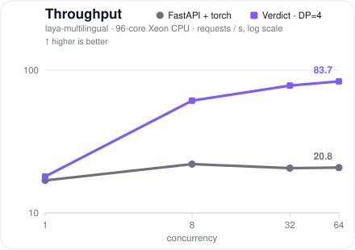
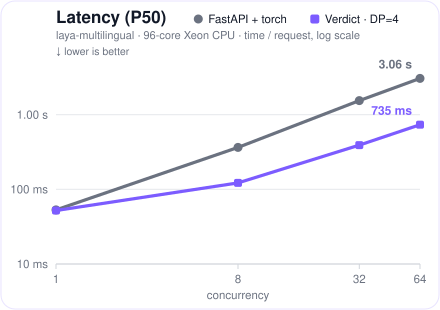
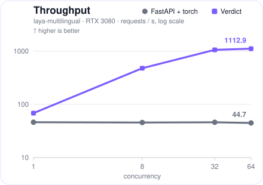
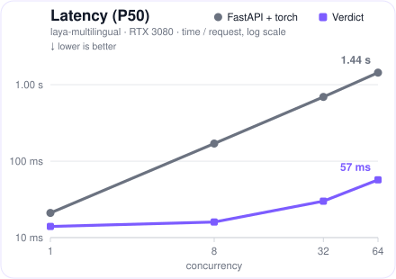

<p align="center">
  
</p>

Verdict is a high-performance serving engine for System One decision models.

**3.8x** on CPU, **23x** on GPU vs FastAPI + torch throughput for [`laya-multilingual`](https://huggingface.co/convaiinnovations/laya-multilingual); **4.2x** and **11x** for [`laya`](https://huggingface.co/convaiinnovations/laya) (see **Performance**).

<p align="center">
  
  
  <br><b>CPU</b>
</p>

<p align="center">
  
  
  <br><b>GPU</b>
</p>

## Quick start

```bash
# the -v mounts cache the model: the first run downloads it, later runs skip the hub
# the CPU image
docker run --rm -p 8080:8080 \
    -v ~/.cache/huggingface:/root/.cache/huggingface \
    -v ~/.cache/verdict:/root/.cache/verdict \
    sgyaqing/verdict:0.1.0-cpu serve verdict-models/laya-multilingual --host 0.0.0.0

# the CUDA image
docker run --rm --gpus all -p 8080:8080 \
    -v ~/.cache/huggingface:/root/.cache/huggingface \
    -v ~/.cache/verdict:/root/.cache/verdict \
    sgyaqing/verdict:0.1.0-cuda serve verdict-models/laya-multilingual --host 0.0.0.0

# hub slow or unreachable: add -e HF_ENDPOINT=https://hf-mirror.com
```

A model source is a local directory or a Hugging Face repo id. Once started, you can test it with:

```bash
curl -s localhost:8080/v1/choice -H 'content-type: application/json' -d '{
  "question": "What should I do for dinner tonight?",
  "state": "Fridge is empty, it'\''s late, and I'\''m tired.",
  "options": ["order delivery", "cook pasta", "skip dinner"]}'
```

## Supported Models

| Verdict-ready model | Languages | One command |
|---|---|---|
| [`verdict-models/laya-multilingual`](https://huggingface.co/verdict-models/laya-multilingual) | 100+ languages | `verdict serve verdict-models/laya-multilingual` |
| [`verdict-models/laya`](https://huggingface.co/verdict-models/laya) | English | `verdict serve verdict-models/laya` |

Both are also mirrored on ModelScope, in the `sgyaqing` namespace:

```bash
# fetches from ModelScope instead of the hub; this path never touches the huggingface cache, hence the single mount
docker run --rm -e VERDICT_USE_MODELSCOPE=1 -p 8080:8080 \
    -v ~/.cache/verdict:/root/.cache/verdict \
    sgyaqing/verdict:0.1.0-cpu serve sgyaqing/laya-multilingual --host 0.0.0.0
```

## API

### `/v1/systemone`

The System One category's native API, defined by Jev and implemented by Laya's runtime, Ollama, LiteLLM, and more.

```bash
curl -s localhost:8080/v1/systemone -H 'content-type: application/json' -d '{
  "state": "Fridge is empty, it'\''s late, and I'\''m tired.",
  "questions": {
    "dinner": {"type": "choice", "instructions": "What should I do for dinner tonight?",
               "criteria": {"order delivery": null, "cook pasta": null, "skip dinner": null}},
    "too_late": {"type": "noul", "instructions": "Is it too late to start cooking?"}
  }}'
```

```json
{
  "model": "laya-multilingual",
  "answers": {
    "dinner": {"type": "choice", "choice": "skip dinner",
               "probabilities": {"order delivery": 0.0124, "cook pasta": 0.0786, "skip dinner": 0.909},
               "confidence": 0.6895},
    "too_late": {"type": "noul", "noul": 0.5068}
  },
  "usage": {"input_tokens": 88, "output_tokens": 0}
}
```

With the official `typesafe-sdk`:

```python
from typesafe_sdk import TypeSafeClient

client = TypeSafeClient(api_key="local", base_url="http://127.0.0.1:8080")
r = client.system_one(
    "Fridge is empty, it's late, and I'm tired.",
    {
        "dinner": {"type": "choice",
                   "instructions": "What should I do for dinner tonight?",
                   "criteria": {"order delivery": None, "cook pasta": None, "skip dinner": None}},
        "too_late": {"type": "noul", "instructions": "Is it too late to start cooking?"},
    },
)
r.answers["dinner"].choice        # "skip dinner"
r.answers["dinner"].confidence    # 0.6895
```

### `/v1/decisions`

The OpenAI Decisions protocol, defined by OpenAI and implemented by LiteLLM, SGLang, and more.

```bash
curl -s localhost:8080/v1/decisions -H 'content-type: application/json' -d '{
  "model": "laya-multilingual",
  "input": "Fridge is empty, it'\''s late, and I'\''m tired.",
  "questions": [
    {"type": "choice", "name": "dinner", "instructions": "What should I do for dinner tonight?",
     "choices": [{"value": "order delivery"}, {"value": "cook pasta"}, {"value": "skip dinner"}]},
    {"type": "predicate", "name": "too_late", "instructions": "Is it too late to start cooking?"}
  ]}'
```

```json
{
  "model": "laya-multilingual",
  "answers": [
    {"type": "choice", "name": "dinner", "choice": "skip dinner", "confidence": 0.6895,
     "probabilities": [{"value": "order delivery", "probability": 0.0124},
                       {"value": "cook pasta", "probability": 0.0786},
                       {"value": "skip dinner", "probability": 0.909}]},
    {"type": "predicate", "name": "too_late", "probability": 0.5068}
  ],
  "usage": {"input_tokens": 88, "output_tokens": 0, "total_tokens": 88,
            "input_tokens_details": {"cache_write_tokens": 0, "cached_tokens": 0},
            "output_tokens_details": {"reasoning_tokens": 0}}
}
```

With the official `openai` SDK (>= 3.26):

```python
from openai import OpenAI

client = OpenAI(base_url="http://127.0.0.1:8080/v1", api_key="local")
d = client.decisions.create(
    model="laya-multilingual",
    input="Fridge is empty, it's late, and I'm tired.",
    questions=[
        {"type": "choice", "name": "dinner",
         "instructions": "What should I do for dinner tonight?",
         "choices": [{"value": "order delivery"}, {"value": "cook pasta"}, {"value": "skip dinner"}]},
        {"type": "predicate", "name": "too_late",
         "instructions": "Is it too late to start cooking?"},
    ],
)
d.answers[0].choice        # "skip dinner"
d.answers[0].confidence    # 0.6895
```

### Single-question endpoints

| Endpoint | Request | Response |
|---|---|---|
| `POST /v1/choice` | `{"question": "Dinner tonight?", "state": "Fridge is empty, it's late.", "options": ["order delivery", "cook pasta"]}` | `{"choice":1,"probabilities":[0.0963,0.9037],"usage":{"input_tokens":25},"latency_ms":22}` |
| `POST /v1/score` | `{"question": "How polite is this reply?", "state": "Support reply: we refunded your order, sorry for the trouble.", "levels": ["terse", "neutral", "warm"]}` | `{"score":0.7665,"probabilities":[0.2348,0.7639,0.0013],"usage":{"input_tokens":44},"latency_ms":26}` |
| `POST /v1/noul` | `{"claim": "The customer got their money back", "state": "Support reply: we refunded your order, sorry for the trouble."}` | `{"probability":0.9587,"usage":{"input_tokens":45},"latency_ms":25}` |
| `GET /health` | | `{"status":"ok","version":"0.1.0"}` |
| `GET /metrics` | | Prometheus text, not JSON: `verdict_requests_total{task="choice"} 1` … |

### OpenAI-compatible layer

`/v1/chat/completions` and `/v1/models`, for SDK compatibility:

```python
from openai import OpenAI

client = OpenAI(base_url="http://127.0.0.1:8080/v1", api_key="local")
r = client.chat.completions.create(
    model="<served-model-name>",
    messages=[{"role": "user", "content": "What should I do for dinner tonight?"}],
    extra_body={
        "state": "Fridge is empty, it's late, and I'm tired.",
        "options": ["order delivery", "cook pasta", "skip dinner"],
    },
)
print(r.choices[0].message.content)   # the selected option, e.g. "skip dinner"
print(r.model_extra["verdict"])       # {"choice": 2, "probabilities": [...]}
```

Decision fields ride as top-level extensions via `extra_body`; whichever is present picks the task: `options` → choice, `levels` → score, `claim` → noul.

### Errors

All errors share one JSON structure -- sending one option to `/v1/choice`, for example:

```json
{"error":{"type":"invalid_request","message":"options must contain at least 2 items (got 1)"}}
```

| `type` | HTTP | when |
|---|---|---|
| `invalid_request` | 400 | malformed body, failed validation, prompts above `--max-input-tokens` (8192) |
| `not_found` | 404 | unknown route |
| `payload_too_large` | 413 | body above 1 MiB |
| `internal` | 500 | engine failure |
| `overloaded` | 503 | queue full -- the request is refused, never dropped |

## Performance

The baseline, **FastAPI + torch**, is the model's own inference path. Every cell reads Verdict / baseline; `c` is the concurrency. `--data-parallel N` runs N engine replicas with the thread budget split cores/N (default 1). Set it on the CPU; on the GPU it is not needed. All CPU numbers below were measured with `--data-parallel 4`.

**Throughput (requests/s), 96-core x86 CPU:**

| Model | c=1 | c=8 | c=32 | c=64 |
|---|---:|---:|---:|---:|
| `laya-multilingual` | 18.0 / 16.9 | 61.3 / 22.0 | 78.2 / 20.6 | 83.7 / 20.8 |
| `laya` | 7.1 / 7.2 | 24.8 / 7.7 | 31.2 / 7.5 | 32.4 / 7.6 |

**P50 latency, 96-core x86 CPU:**

| Model | c=1 | c=8 | c=32 | c=64 |
|---|---|---:|---:|---:|
| `laya-multilingual` | 52 ms / 53 ms | 122 ms / 365 ms | 391 ms / 1.54 s | 735 ms / 3.06 s |
| `laya` | 138 ms / 137 ms | 281 ms / 1.02 s | 970 ms / 4.28 s | 1.89 s / 8.42 s |

**Throughput (requests/s), RTX 3080:**

| Model | c=1 | c=8 | c=32 | c=64 |
|---|---:|---:|---:|---:|
| `laya-multilingual` | 68.4 / 46.2 | 478.5 / 45.6 | 1058.6 / 46.0 | 1112.9 / 44.7 |
| `laya` | 64.5 / 35.1 | 276.0 / 34.7 | 408.4 / 37.8 | 417.6 / 37.1 |

**P50 latency, RTX 3080:**

| Model | c=1 | c=8 | c=32 | c=64 |
|---|---|---:|---:|---:|
| `laya-multilingual` | 14 ms / 21 ms | 16 ms / 170 ms | 30 ms / 691 ms | 57 ms / 1.44 s |
| `laya` | 15 ms / 27 ms | 29 ms / 228 ms | 78 ms / 844 ms | 153 ms / 1.74 s |

On the 96-core host above, `--data-parallel 4` is optimal: 2 reaches ~90% of its throughput, and 8 regresses as each replica's threads fall below the single-forward latency plateau. On your machine, benchmark `--data-parallel` to find the right value.

## Correctness methodology

Verdict runs its own inference pipeline and every layer is verified against the official model: on CPU the answers are bit-for-bit identical; on CUDA they match to within 1e-4 -- 10x tighter than the industry norm. Same decisions, faster.

## Configuration

One subcommand: `verdict serve <MODEL_DIR_OR_REPO>`.

| Flag | Default | Meaning |
|---|---|---|
| `--host` / `--port` | 127.0.0.1 / 8080 | address and port to serve on |
| `--device` | auto | `auto` uses CUDA when available, else CPU; `cpu` / `cuda` force the choice |
| `--max-batch-size` | 32 | max requests per batch |
| `--batch-window-ms` | 5 | how long to wait for more requests before running a batch |
| `--max-input-tokens` | 8192 | reject prompts longer than this many tokens |
| `--queue-cap` | 1024 | max queued requests; excess requests are rejected with 503 |
| `--served-model-name` | model directory's name | the model name clients address |
| `--policy` | fcfs | `fcfs` serves in arrival order; `priority` serves lower request priority first |
| `--data-parallel` | 1 | N engine replicas with the thread budget split cores/N |

Environment variables:

| Variable | Effect |
|---|---|
| `HF_ENDPOINT` | Hugging Face hub URL; a mirror (e.g. `https://hf-mirror.com`) helps when the hub is slow. |
| `HF_TOKEN` | Auth for gated Hugging Face repos. |
| `VERDICT_USE_MODELSCOPE` | `1` or `true` resolves repo ids against ModelScope; anything else stays on Hugging Face. |
| `MODELSCOPE_API_TOKEN` | Auth for ModelScope repos. |
| `ORT_DYLIB_PATH` | Path to the onnxruntime library; default: `<MODEL_DIR>/lib/`. |
| `XDG_CACHE_HOME` | Path to the model cache root; default: `~/.cache/verdict`. |

## Requirements

For the CUDA image:

| | Minimum |
|---|---|
| GPU | compute capability **7.5** or newer |
| Driver | **580** or newer on Linux |

## Roadmap

- **v0.2** -- support for Qwen-based System One models, with a public conversion tool.

## License

Apache-2.0
