<p align="center">
  
</p>

Verdict is a high-performance serving engine for System One decision models.

Up to **66x** the throughput of the model authors' own servers, with the same answers as the official SDKs (see **Performance** and **Correctness**).

<details open>
<summary><strong>decider-2b</strong></summary>

<p align="center">
  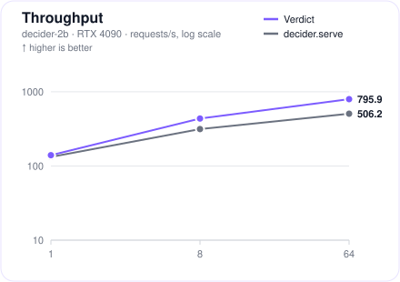
  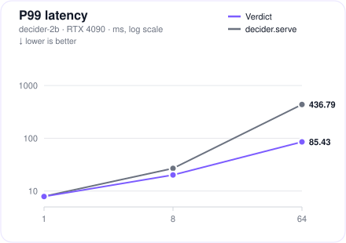
  <br><b>GPU only</b>
</p>

</details>

<details>
<summary><strong>von</strong></summary>

<p align="center">
  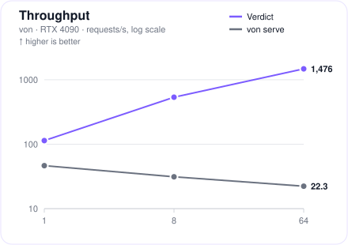
  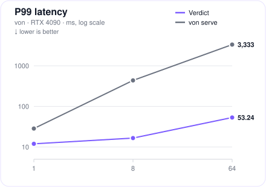
  <br><b>GPU</b>
</p>

<p align="center">
  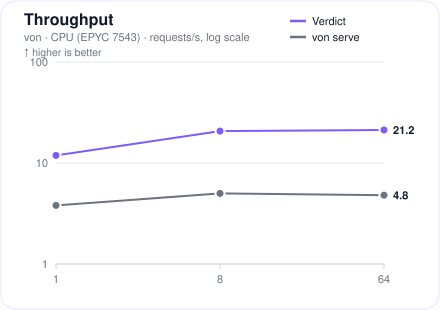
  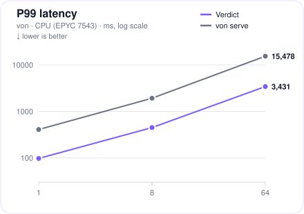
  <br><b>CPU</b>
</p>

</details>

<details>
<summary><strong>laya-multilingual</strong></summary>

<p align="center">
  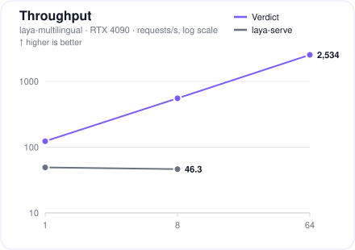
  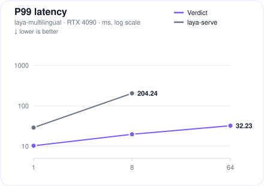
  <br><b>GPU</b>
</p>

<p align="center">
  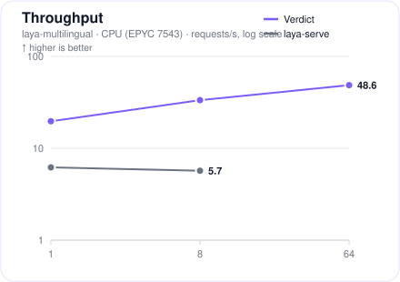
  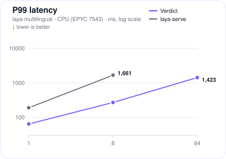
  <br><b>CPU</b>
</p>

The official server refused requests at concurrency 64, so its line ends at concurrency 8.

</details>

<details>
<summary><strong>laya</strong></summary>

<p align="center">
  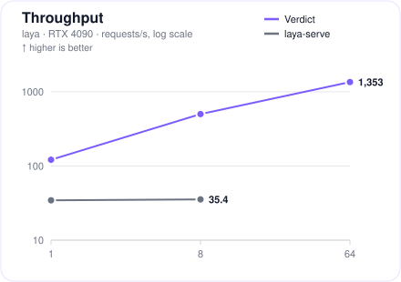
  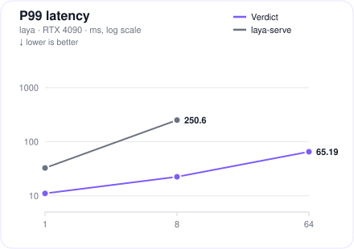
  <br><b>GPU</b>
</p>

<p align="center">
  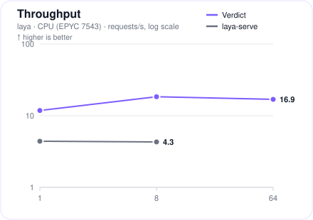
  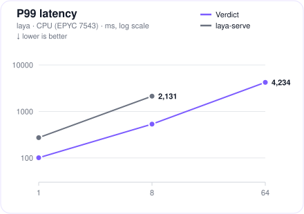
  <br><b>CPU</b>
</p>

The official server refused requests at concurrency 64, so its line ends at concurrency 8.

</details>

## Quick start

```bash
# the -v mount caches the model: the first run downloads it, later runs reuse the cache
docker run --rm --gpus all -p 8080:8080 \
    -v ~/.cache/verdict:/root/.cache/verdict \
    sgyaqing/verdict:0.2.0-cuda serve verdict-models/decider-2b --host 0.0.0.0

# ModelScope:
docker run --rm --gpus all -p 8080:8080 \
    -e VERDICT_USE_MODELSCOPE=1 \
    -v ~/.cache/verdict:/root/.cache/verdict \
    sgyaqing/verdict:0.2.0-cuda serve sgyaqing/decider-2b --host 0.0.0.0
```

Once started, you can test it with:

```bash
curl -s localhost:8080/v1/choice -H 'content-type: application/json' -d '{
  "question": "What should I do for dinner tonight?",
  "state": "Fridge is empty, it'\''s late, and I'\''m tired.",
  "options": ["order delivery", "cook pasta", "skip dinner"]}'
```

## Supported Models

| Verdict-ready&nbsp;model | Languages | One&nbsp;command |
|---|---|---|
| [`verdict-models/decider-2b`](https://huggingface.co/verdict-models/decider-2b) | English | `verdict serve verdict-models/decider-2b` |
| [`verdict-models/von`](https://huggingface.co/verdict-models/von) | English | `verdict serve verdict-models/von` |
| [`verdict-models/laya-multilingual`](https://huggingface.co/verdict-models/laya-multilingual) | 100+ languages | `verdict serve verdict-models/laya-multilingual` |
| [`verdict-models/laya`](https://huggingface.co/verdict-models/laya) | English | `verdict serve verdict-models/laya` |

All four are also mirrored on ModelScope, in the `sgyaqing` namespace:

```bash
# fetches from ModelScope instead of Hugging Face
VERDICT_USE_MODELSCOPE=1 verdict serve sgyaqing/laya-multilingual
```

## API

### `/v1/systemone`

The System One category's native API, defined by Jev and implemented by Laya's runtime, Ollama, LiteLLM, and more.

```bash
curl -s localhost:8080/v1/systemone -H 'content-type: application/json' -d '{
  "state": "Fridge is empty, it'\''s late, and I'\''m tired.",
  "questions": {
    "dinner": {"type": "choice", "instructions": "What should I do for dinner tonight?",
               "criteria": {"order delivery": null, "cook pasta": null, "skip dinner": null}},
    "too_late": {"type": "noul", "instructions": "Is it too late to start cooking?"}
  }}'
```

```json
{
  "model": "laya-multilingual",
  "answers": {
    "dinner": {"type": "choice", "choice": "skip dinner",
               "probabilities": {"order delivery": 0.0124, "cook pasta": 0.0786, "skip dinner": 0.909},
               "confidence": 0.6895},
    "too_late": {"type": "noul", "noul": 0.5068}
  },
  "usage": {"input_tokens": 88, "output_tokens": 0}
}
```

With the official `typesafe-sdk`:

```python
from typesafe_sdk import TypeSafeClient

client = TypeSafeClient(api_key="local", base_url="http://127.0.0.1:8080")
r = client.system_one(
    "Fridge is empty, it's late, and I'm tired.",
    {
        "dinner": {"type": "choice",
                   "instructions": "What should I do for dinner tonight?",
                   "criteria": {"order delivery": None, "cook pasta": None, "skip dinner": None}},
        "too_late": {"type": "noul", "instructions": "Is it too late to start cooking?"},
    },
)
r.answers["dinner"].choice        # "skip dinner"
r.answers["dinner"].confidence    # 0.6895
```

### `/v1/decisions`

The OpenAI Decisions protocol, defined by OpenAI and implemented by LiteLLM, SGLang, and more.

```bash
curl -s localhost:8080/v1/decisions -H 'content-type: application/json' -d '{
  "model": "laya-multilingual",
  "input": "Fridge is empty, it'\''s late, and I'\''m tired.",
  "questions": [
    {"type": "choice", "name": "dinner", "instructions": "What should I do for dinner tonight?",
     "choices": [{"value": "order delivery"}, {"value": "cook pasta"}, {"value": "skip dinner"}]},
    {"type": "predicate", "name": "too_late", "instructions": "Is it too late to start cooking?"}
  ]}'
```

```json
{
  "model": "laya-multilingual",
  "answers": [
    {"type": "choice", "name": "dinner", "choice": "skip dinner", "confidence": 0.6895,
     "probabilities": [{"value": "order delivery", "probability": 0.0124},
                       {"value": "cook pasta", "probability": 0.0786},
                       {"value": "skip dinner", "probability": 0.909}]},
    {"type": "predicate", "name": "too_late", "probability": 0.5068}
  ],
  "usage": {"input_tokens": 88, "output_tokens": 0, "total_tokens": 88,
            "input_tokens_details": {"cache_write_tokens": 0, "cached_tokens": 0},
            "output_tokens_details": {"reasoning_tokens": 0}}
}
```

With the official `openai` SDK (>= 3.26):

```python
from openai import OpenAI

client = OpenAI(base_url="http://127.0.0.1:8080/v1", api_key="local")
d = client.decisions.create(
    model="laya-multilingual",
    input="Fridge is empty, it's late, and I'm tired.",
    questions=[
        {"type": "choice", "name": "dinner",
         "instructions": "What should I do for dinner tonight?",
         "choices": [{"value": "order delivery"}, {"value": "cook pasta"}, {"value": "skip dinner"}]},
        {"type": "predicate", "name": "too_late",
         "instructions": "Is it too late to start cooking?"},
    ],
)
d.answers[0].choice        # "skip dinner"
d.answers[0].confidence    # 0.6895
```

### Single-question endpoints

| Endpoint | Request | Response |
|---|---|---|
| `POST /v1/choice` | `{"question": "Dinner tonight?", "state": "Fridge is empty, it's late.", "options": ["order delivery", "cook pasta"]}` | `{"choice":1,"probabilities":[0.0963,0.9037],"usage":{"input_tokens":25},"latency_ms":22}` |
| `POST /v1/score` | `{"question": "How polite is this reply?", "state": "Support reply: we refunded your order, sorry for the trouble.", "levels": ["terse", "neutral", "warm"]}` | `{"score":0.7665,"probabilities":[0.2348,0.7639,0.0013],"usage":{"input_tokens":44},"latency_ms":26}` |
| `POST /v1/noul` | `{"claim": "The customer got their money back", "state": "Support reply: we refunded your order, sorry for the trouble."}` | `{"probability":0.9587,"usage":{"input_tokens":45},"latency_ms":25}` |
| `GET /health` | | `{"status":"ok","version":"0.2.0"}` |
| `GET /metrics` | | Prometheus text, not JSON: `verdict_requests_total{task="choice"} 1` … |

### OpenAI-compatible layer

`/v1/chat/completions` and `/v1/models`, for SDK compatibility:

```python
from openai import OpenAI

client = OpenAI(base_url="http://127.0.0.1:8080/v1", api_key="local")
r = client.chat.completions.create(
    model="<served-model-name>",
    messages=[{"role": "user", "content": "What should I do for dinner tonight?"}],
    extra_body={
        "state": "Fridge is empty, it's late, and I'm tired.",
        "options": ["order delivery", "cook pasta", "skip dinner"],
    },
)
print(r.choices[0].message.content)   # the selected option, e.g. "skip dinner"
print(r.model_extra["verdict"])       # {"choice": 2, "probabilities": [...]}
```

Decision fields ride as top-level extensions via `extra_body`; whichever is present picks the task: `options` → choice, `levels` → score, `claim` → noul.

### Errors

All errors share one JSON structure -- sending one option to `/v1/choice`, for example:

```json
{"error":{"type":"invalid_request","message":"options must contain at least 2 items (got 1)"}}
```

| `type` | HTTP | when |
|---|---|---|
| `invalid_request` | 400 | malformed body, failed validation, prompts above `--max-input-tokens` (8192) |
| `not_found` | 404 | unknown route |
| `payload_too_large` | 413 | body above 1 MiB |
| `internal` | 500 | engine failure |
| `overloaded` | 503 | queue full -- the request is refused, never dropped |

## Performance

All numbers measured on one machine (RTX 4090, AMD EPYC 7543), end to end over HTTP, each model against its author's own server (`laya-serve` 0.4.7, `von serve` from von-sdk 1.3.7, `decider.serve` from decider-ai 1.9.0). CPU measurements were taken on the same host with the GPU idle. A ratio above 1x means Verdict is ahead. Click a model to expand its tables.

<details open>
<summary><strong>decider-2b</strong></summary>

**GPU**

| concurrency | Verdict&nbsp;rps | `decider.serve`&nbsp;rps | rps&nbsp;ratio | Verdict&nbsp;P50&nbsp;/&nbsp;P99&nbsp;(ms) | `decider.serve`&nbsp;P50&nbsp;/&nbsp;P99&nbsp;(ms) | P50&nbsp;/&nbsp;P99&nbsp;ratio |
|---|---:|---:|---:|---:|---:|---:|
| 1 | 139.6 | 132.4 | 1.05x | 6.91&nbsp;/&nbsp;7.88 | 7.51&nbsp;/&nbsp;7.94 | 1.09&nbsp;/&nbsp;1.01x |
| 8 | 436.5 | 314.0 | 1.39x | 18.23&nbsp;/&nbsp;20.17 | 25.41&nbsp;/&nbsp;26.87 | 1.39&nbsp;/&nbsp;1.33x |
| 64 | 795.9 | 506.2 | 1.57x | 80.13&nbsp;/&nbsp;85.43 | 112.91&nbsp;/&nbsp;436.79 | 1.41&nbsp;/&nbsp;5.11x |

</details>

<details>
<summary><strong>von</strong></summary>

**GPU**

| concurrency | Verdict&nbsp;rps | `von serve`&nbsp;rps | rps&nbsp;ratio | Verdict&nbsp;P50&nbsp;/&nbsp;P99&nbsp;(ms) | `von serve`&nbsp;P50&nbsp;/&nbsp;P99&nbsp;(ms) | P50&nbsp;/&nbsp;P99&nbsp;ratio |
|---|---:|---:|---:|---:|---:|---:|
| 1 | 113.8 | 46.4 | 2.45x | 8.61&nbsp;/&nbsp;11.98 | 22.89&nbsp;/&nbsp;28.46 | 2.66&nbsp;/&nbsp;2.38x |
| 8 | 536.4 | 31.2 | 17.2x | 14.86&nbsp;/&nbsp;16.61 | 250.91&nbsp;/&nbsp;435.99 | 16.9&nbsp;/&nbsp;26.2x |
| 64 | 1476.1 | 22.3 | 66.1x | 42.58&nbsp;/&nbsp;53.24 | 2848.80&nbsp;/&nbsp;3333.40 | 66.9&nbsp;/&nbsp;62.6x |

**CPU**

| concurrency | Verdict&nbsp;rps | `von serve`&nbsp;rps | rps&nbsp;ratio | Verdict&nbsp;P50&nbsp;/&nbsp;P99&nbsp;(ms) | `von serve`&nbsp;P50&nbsp;/&nbsp;P99&nbsp;(ms) | P50&nbsp;/&nbsp;P99&nbsp;ratio |
|---|---:|---:|---:|---:|---:|---:|
| 1 | 11.9 | 3.8 | 3.11x | 83.11&nbsp;/&nbsp;97.55 | 272.53&nbsp;/&nbsp;409.13 | 3.28&nbsp;/&nbsp;4.19x |
| 8 | 20.7 | 5.0 | 4.17x | 383.82&nbsp;/&nbsp;449.74 | 1607.00&nbsp;/&nbsp;1927.80 | 4.19&nbsp;/&nbsp;4.29x |
| 64 | 21.2 | 4.8 | 4.37x | 2989.60&nbsp;/&nbsp;3430.80 | 13644.60&nbsp;/&nbsp;15478.20 | 4.56&nbsp;/&nbsp;4.51x |

</details>

<details>
<summary><strong>laya-multilingual</strong></summary>

**GPU**

| concurrency | Verdict&nbsp;rps | `laya-serve`&nbsp;rps | rps&nbsp;ratio | Verdict&nbsp;P50&nbsp;/&nbsp;P99&nbsp;(ms) | `laya-serve`&nbsp;P50&nbsp;/&nbsp;P99&nbsp;(ms) | P50&nbsp;/&nbsp;P99&nbsp;ratio |
|---|---:|---:|---:|---:|---:|---:|
| 1 | 123.2 | 49.1 | 2.51x | 8.03&nbsp;/&nbsp;10.29 | 18.54&nbsp;/&nbsp;28.92 | 2.31&nbsp;/&nbsp;2.81x |
| 8 | 553.4 | 46.3 | 11.9x | 13.99&nbsp;/&nbsp;19.79 | 184.36&nbsp;/&nbsp;204.24 | 13.2&nbsp;/&nbsp;10.3x |
| 64 | 2534.4 | refused&nbsp;requests | — | 24.67&nbsp;/&nbsp;32.23 | refused&nbsp;requests | — |

**CPU**

| concurrency | Verdict&nbsp;rps | `laya-serve`&nbsp;rps | rps&nbsp;ratio | Verdict&nbsp;P50&nbsp;/&nbsp;P99&nbsp;(ms) | `laya-serve`&nbsp;P50&nbsp;/&nbsp;P99&nbsp;(ms) | P50&nbsp;/&nbsp;P99&nbsp;ratio |
|---|---:|---:|---:|---:|---:|---:|
| 1 | 19.7 | 6.2 | 3.16x | 50.51&nbsp;/&nbsp;64.37 | 161.13&nbsp;/&nbsp;189.54 | 3.19&nbsp;/&nbsp;2.94x |
| 8 | 33.4 | 5.7 | 5.84x | 238.10&nbsp;/&nbsp;269.73 | 1396.60&nbsp;/&nbsp;1661.30 | 5.87&nbsp;/&nbsp;6.16x |
| 64 | 48.6 | refused&nbsp;requests | — | 1312.40&nbsp;/&nbsp;1422.60 | refused&nbsp;requests | — |

</details>

<details>
<summary><strong>laya</strong></summary>

**GPU**

| concurrency | Verdict&nbsp;rps | `laya-serve`&nbsp;rps | rps&nbsp;ratio | Verdict&nbsp;P50&nbsp;/&nbsp;P99&nbsp;(ms) | `laya-serve`&nbsp;P50&nbsp;/&nbsp;P99&nbsp;(ms) | P50&nbsp;/&nbsp;P99&nbsp;ratio |
|---|---:|---:|---:|---:|---:|---:|
| 1 | 121.4 | 34.4 | 3.53x | 8.37&nbsp;/&nbsp;11.07 | 28.58&nbsp;/&nbsp;32.73 | 3.42&nbsp;/&nbsp;2.96x |
| 8 | 501.4 | 35.4 | 14.2x | 15.99&nbsp;/&nbsp;22.42 | 227.96&nbsp;/&nbsp;250.60 | 14.3&nbsp;/&nbsp;11.2x |
| 64 | 1353.0 | refused&nbsp;requests | — | 46.71&nbsp;/&nbsp;65.19 | refused&nbsp;requests | — |

**CPU**

| concurrency | Verdict&nbsp;rps | `laya-serve`&nbsp;rps | rps&nbsp;ratio | Verdict&nbsp;P50&nbsp;/&nbsp;P99&nbsp;(ms) | `laya-serve`&nbsp;P50&nbsp;/&nbsp;P99&nbsp;(ms) | P50&nbsp;/&nbsp;P99&nbsp;ratio |
|---|---:|---:|---:|---:|---:|---:|
| 1 | 11.8 | 4.4 | 2.67x | 84.21&nbsp;/&nbsp;100.87 | 223.81&nbsp;/&nbsp;273.16 | 2.66&nbsp;/&nbsp;2.71x |
| 8 | 18.4 | 4.3 | 4.23x | 436.70&nbsp;/&nbsp;533.71 | 1882.50&nbsp;/&nbsp;2131.30 | 4.31&nbsp;/&nbsp;3.99x |
| 64 | 16.9 | refused&nbsp;requests | — | 3796.80&nbsp;/&nbsp;4233.90 | refused&nbsp;requests | — |

</details>

## Correctness

Verdict runs its own inference pipeline, graded against a golden standard: the official SDK's offline output on CPU fp32. In accuracy PKs, Verdict and the model author's own server are graded against the same golden standard on one RTX 4090 (CUDA) — worst-case deviation across the whole corpus:

| Model | Verdict | official&nbsp;server | result |
|---|---:|---:|:--|
| laya | 0.0 | 0.943 | Verdict ahead |
| laya-multilingual | 1e-4 | 1.74 | Verdict ahead |
| von | 0.0 | 0.0 | tied |
| decider-2b | 1.24e-2 | 1.06e-2 | tied |

## Configuration

One subcommand: `verdict serve <MODEL_DIR_OR_REPO>`.

| Flag | Default | Meaning |
|---|---|---|
| `--host` / `--port` | 127.0.0.1&nbsp;/&nbsp;8080 | address and port to serve on |
| `--device` | auto | `auto` uses CUDA when available, else CPU; `cpu` / `cuda` force the choice |
| `--max-batch-size` | 32 | max requests per batch |
| `--batch-window-ms` | 5 | how long to wait for more requests before running a batch |
| `--max-input-tokens` | 8192 | reject prompts longer than this many tokens |
| `--queue-cap` | 1024 | max queued requests; excess requests are rejected with 503 |
| `--served-model-name` | model directory's name | the model name clients address |
| `--policy` | fcfs | `fcfs` serves in arrival order; `priority` serves lower request priority first |
| `--data-parallel` | 1 | N engine replicas; helps on many-core CPU hosts |
| `--force-download` | — | if passed, re-download the model package instead of using the cache |

Environment variables:

| Variable | Effect |
|---|---|
| `HF_ENDPOINT` | Alternate Hugging Face endpoint, for fetching through a mirror. |
| `HF_TOKEN` | Auth for gated Hugging Face repos. |
| `VERDICT_USE_MODELSCOPE` | `1` or `true` resolves all repo ids against ModelScope; unset or any other value keeps everything on Hugging Face. |
| `MODELSCOPE_API_TOKEN` | Auth for ModelScope repos. |
| `VERDICT_CACHE` | Model cache root; default `$XDG_CACHE_HOME/verdict`, i.e. `~/.cache/verdict`. |
| `ORT_DYLIB_PATH` | Path to the onnxruntime library; default: the model's `lib/` or beside the binary. |

## Requirements

For the CUDA image:

| | Minimum |
|---|---|
| GPU | compute capability **7.5** or newer |
| Driver | **580** or newer on Linux |

`decider-2b` serves through the PyTorch runtime, which in v0.2 runs only on CUDA GPUs.

## Roadmap

- **v0.2.5** -- a public conversion tool: turn a System One checkpoint into a Verdict-ready package with one command.

## License

Apache-2.0
